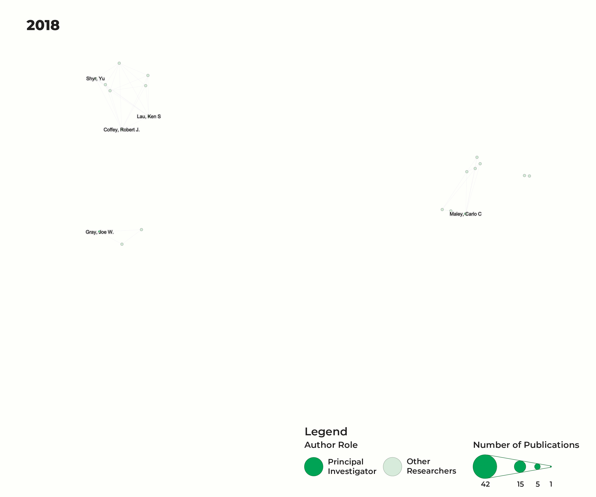
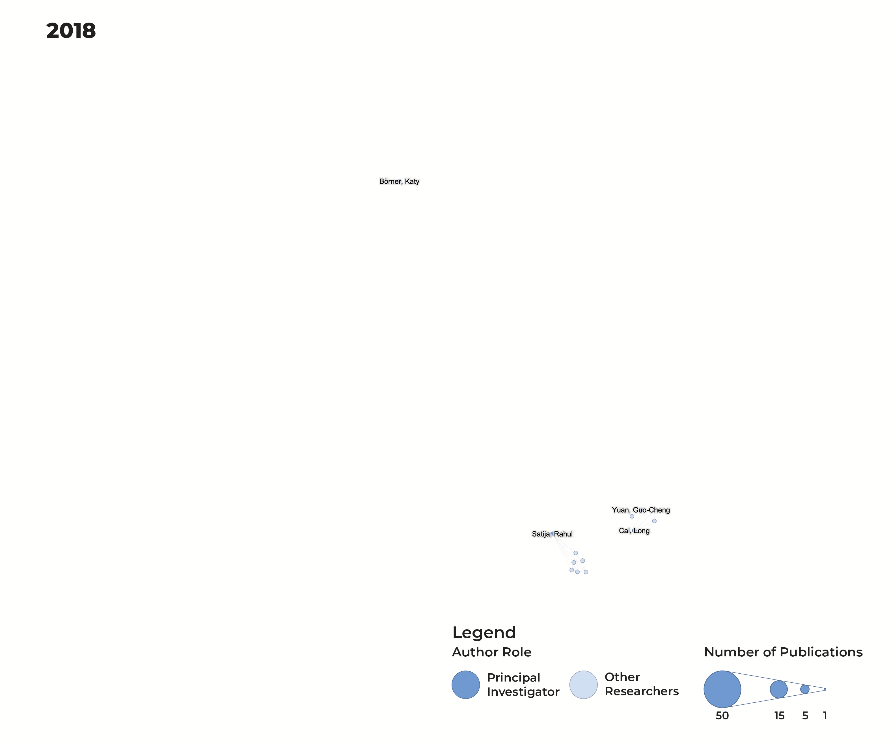
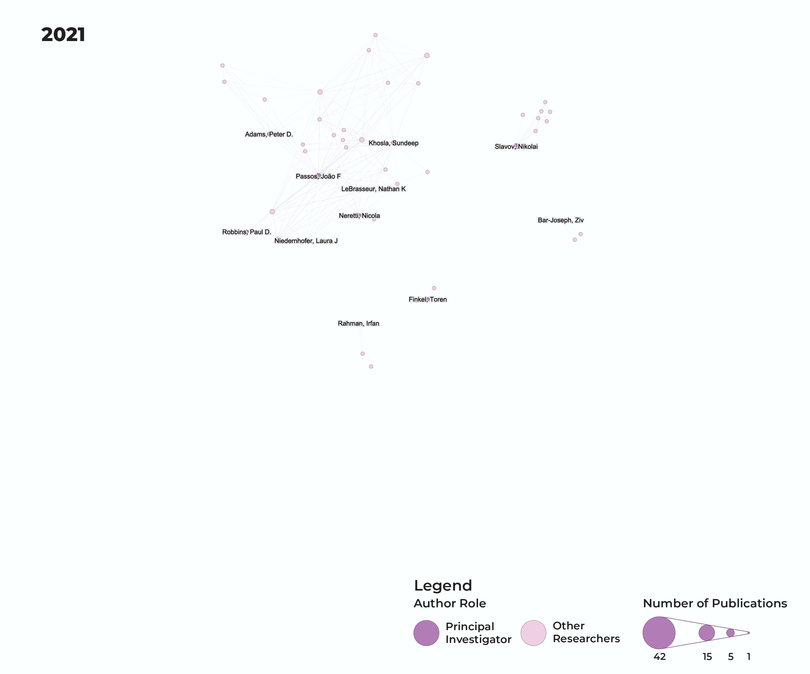

# Research Collaborations Within and Across Disciplines in NIH-Funded Atlas Programs
Michael P. Ginda<sup>1</sup>, Yongxin Kong<sup>1</sup>, Katy Börner<sup>1*</sup>

<sup>1</sup> Department of Engineering, Luddy School of Informatics, Computing, and Engineering, Indiana University, Bloomington, IN, USA  

## Abstract

The National Institutes of Health (NIH) fund several programs (aka consortia) that support the construction of organ-specific or whole person atlases. These initiatives are designed to build comprehensive open reference datasets while advancing knowledge graphs, analytics, visualizations, and user interfaces needed to explore multiscale human atlas data. Here, we compare the Human Tumor Atlas Network (HTAN), Human BioMolecular Atlas Program (HuBMAP) and Cellular Senescence Network (SenNet) to examine collaboration by consortium component (CC) and researcher role and its relation to scientific impact. We retrieved 884 NIH award records and identified 1,255 focal publications acknowledging these awards, involving 8,952 researchers; compiled 99,108 citing publications covering 93% of the focal publications; constructed co-authorship networks; and as single-project publications or internal collaborations (IC), including intra-CC and inter-CCs collaborations. within each atlas program. Results show that IC publications are rare but involve many funded projects and principal investigators (PIs). Technology-oriented CCs tend to engage in intra-CC collaboration, whereas experimental-oriented CCs often collaborate across CCs of the same type. Compared with other researchers, PIs exhibited a significantly stronger association with inter-CCs than with single-project publications. IC publications have higher mean Relative Citation Ratios than single-project publications. Inter-CCs publications have significantly higher cumulative and annual citation levels in the first five post-publication years. Study methods and results can be used to inform the funding, management, and impact reporting for future Big Science programs that bring together 300+ experts from different disciplines to address major research challenges.  

## Project Structure
This repository documents data, scripts and analysis products of a scientometric analysis of three National Institutes of Health (NIH) Biomedical Map initiatives:
* [Human BioMolecular Atlas Program (HuBMAP)](https://hubmapconsortium.org/) 
* [Cellular Senescence Network (SenNet)](https://sennetconsortium.org/)
* [Human Tumor Atlas Network (HTAN)](https://humantumoratlas.org/)
  
```
├── data/
│   ├── awards/                 # Original awards data files (read-only)
│   ├── metadata/               # NIH Map Intiative organization division metadata
│   ├── publications/		        # Original publication data files (read-only)
│   ├── processed/              # Cleaned and integrated data
│   ├── citations/              # Citation data
│   ├── name_disambiguation/    # Name disambiguation data
│   ├── networks/               # Network data sets (node and edge lists, network files (e.g., .gexf))
│   └── results/                # Results data sets
├── scripts/                    # Scripts used in setup, data prepartion, analysis and reporting.
├── notebooks/
│   ├── data_analysis/         # Main analysis notebooks
├── outputs/
│   ├── figures/
│   ├── tables/
│   └── reports/
└── docs/                       # Documentation and codebooks

```

## [Co-authorship Network](https://cns-iu.github.io/nih-atlas-supporting-information/index.html#co-authorship-network)

### HTAN



### HuBMAP



### SenNet



## Data Sources

### NIH Opportunity Numbers
- NIH Opportunity numbers were collected from the [HuBMAP Funding](https://commonfund.nih.gov/HuBMAP/fundedresearch) and [SenNet Funding](https://commonfund.nih.gov/senescence/fundedresearch) websites hosted by the NIH Common Fund Data Ecosystem (CFDE).
- HTAN opportunity numbers were identified via a search of NIH Reporter database using project serial numbers supplied by a PubMed query linked from the the [HTAN Publication](https://humantumoratlas.org/publications) website.

### NIH Award and Publication Data
- NIH Reporter database was queried using Opportunity Number (RFA and OTA) and project serial numbers associated with NIH Biomedical Map Initiatives, which provides initial NIH awards and funding data and publications reported by principle investigators who received awards for these programs.
- NIH Reporter database queries using project serial numbers were used to identify administrative supplements to existing NIH grants and cooperative agreements (e.g., PA-18-591)

### Citation Data
- Citation data were obtained from OpenAlex ([https://openalex.org/](https://openalex.org/)) by matching publications using PubMed identifiers and retrieving their citing works through the OpenAlex Works API. The updated OpenAlex snapshot was collected on September 24, 2026.

## Analysis Plan

### Phase 1: Data Cleaning & Integration 
1. Prepare NIH Reporter Awards data
2. Prepare NIH Reporter Publications data
3. Create integrated consortium datasets
4. Generate initial data quality reports

### Phase 2: Citation Collection
1. Collect Google Scholar citations
2. Retrieve Web of Science data via PMIDs
3. Integrate citation metrics with publication data

### Phase 3: Disambiguate Research Names (Current)
1. Create author and principle investigator name lists
2. Disambiguate name lists using Open Refine.
3. Integrate disambiguated names to publication data

### Phase 4: Analysis
1. Funding patterns and consortium organization
2. Collaboration network analysis
3. Publication impact assessment

## Getting Started
1. Place initial data files in appropriate `data/awards/`, `data/publications`, `data/metadata` subdirectories
2. Run data preparation workflow.
3. Run name disambiguation workflows.
4. Run co-authorship network creation workflow.
5. Run data analysis and visualization analysis notebooks.

## Dependencies
See `scripts/00_setup.R` for required R packages
